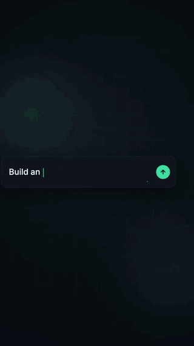
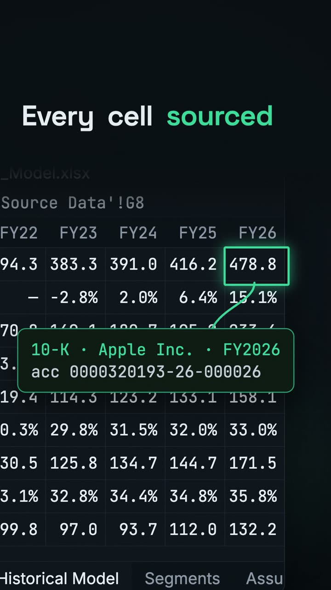

<p align="center"><a href="https://edgarstack.com/?utm_source=github&utm_medium=readme&utm_campaign=edgarstack_mcp"></a></p>

<p align="center"></p>

<h3 align="center">SEC EDGAR financials for your AI assistant.<br>Every reported figure comes with its XBRL tag, period end and filing link.</h3>

<p align="center">
  <a href="https://edgarstack.com/beta?utm_source=github&utm_medium=readme&utm_campaign=edgarstack_mcp"><b>Get a free beta key</b></a> ·
  <a href="https://edgarstack.com/docs?utm_source=github&utm_medium=readme">Docs</a> ·
  <a href="https://edgarstack.com/methodology?utm_source=github&utm_medium=readme#accuracy">Accuracy check</a> ·
  <a href="https://registry.modelcontextprotocol.io/v0/servers?search=edgarstack">MCP Registry</a> ·
  <a href="https://mcp.so/server/edgarstack">mcp.so</a> ·
  <a href="https://glama.ai/mcp/connectors/com.edgarstack/edgar-stack">Glama</a>
</p>

---

AI assistants answer financial questions in seconds, but rarely say where a number came from. EdgarStack is a hosted [Model Context Protocol](https://modelcontextprotocol.io) server that gives Claude, ChatGPT, Cursor, VS Code, Gemini CLI and other MCP clients standardized data from SEC EDGAR filings, with the source attached:

```text
You:        What was Apple's revenue last fiscal year?
EdgarStack: $478,834M  ·  FY2026, period ended 2026-09-26
            XBRL tag: RevenueFromContractWithCustomerExcludingAssessedTax
            Filing:   Apple Inc. 10-K filed 2026-11-03, accession 0000320193-26-000026
            Link:     https://www.sec.gov/Archives/edgar/data/320193/000032019326000026/0000320193-26-000026-index.htm
```

> **Free beta until 31 December 2026.** [Request a key](https://edgarstack.com/beta?utm_source=github&utm_medium=readme&utm_campaign=edgarstack_mcp); approval is automatic.

## Watch it build

One prompt in Claude → a 16-sheet Excel model of Apple, built from its 10-K filings (36 seconds, sound on).

<p align="center"><a href="assets/edgarstack-skeleton-model.mp4"></a></p>

## Quick start

Server URL (OAuth sign-in with your beta key):

```text
https://edgarstack.com/mcp
```

<details open>
<summary><b>Claude</b> (web and desktop, paid plans)</summary>

Settings → Connectors → **Add custom connector** → paste the URL → Connect, and sign in with your beta key.
</details>

<details>
<summary><b>ChatGPT</b> (Developer mode)</summary>

Turn on Developer mode in Settings → Apps, add a custom MCP server with the URL, and sign in with your beta key. Availability depends on your ChatGPT plan.
</details>

<details>
<summary><b>Claude Code</b></summary>

```bash
claude mcp add --transport http edgarstack https://edgarstack.com/mcp
```
</details>

<details>
<summary><b>Cursor</b></summary>

`~/.cursor/mcp.json` (all projects) or `.cursor/mcp.json` (one project):

```json
{
  "mcpServers": {
    "edgarstack": { "url": "https://edgarstack.com/mcp" }
  }
}
```
</details>

<details>
<summary><b>VS Code</b> (GitHub Copilot agent mode)</summary>

`.vscode/mcp.json`:

```json
{
  "servers": {
    "edgarstack": { "type": "http", "url": "https://edgarstack.com/mcp" }
  }
}
```
</details>

<details>
<summary><b>Gemini CLI</b></summary>

```bash
gemini extensions install https://github.com/thetusharchadha/edgarstack-mcp
```
</details>

<details>
<summary><b>Clients without OAuth</b> (for example Open WebUI)</summary>

Put your key in the URL: `https://edgarstack.com/mcp/<your-api-key>`. Treat that URL like a password.
</details>

Full guides for each client: [edgarstack.com/setup](https://edgarstack.com/setup?utm_source=github&utm_medium=readme).

## Try these prompts

Two real answers, as EdgarStack returned them on 25 November 2026:

<details open>
<summary><b>"Show Apple's last five years of revenue and operating income, with the filing each figure came from."</b></summary>

| Fiscal year | Revenue | Operating income | Source 10-K |
|---|---:|---:|---|
| FY2026 | $478,834M | $158,063M | [0000320193-26-000026](https://www.sec.gov/Archives/edgar/data/320193/000032019326000026/0000320193-26-000026-index.htm) |
| FY2025 | $416,161M | $133,050M | [0000320193-26-000026](https://www.sec.gov/Archives/edgar/data/320193/000032019326000026/0000320193-26-000026-index.htm) |
| FY2024 | $391,035M | $123,216M | [0000320193-26-000026](https://www.sec.gov/Archives/edgar/data/320193/000032019326000026/0000320193-26-000026-index.htm) |
| FY2023 | $383,285M | $114,301M | [0000320193-25-000079](https://www.sec.gov/Archives/edgar/data/320193/000032019325000079/0000320193-25-000079-index.htm) |
| FY2022 | $394,328M | $119,437M | [0000320193-24-000123](https://www.sec.gov/Archives/edgar/data/320193/000032019324000123/0000320193-24-000123-index.htm) |

XBRL tags: `RevenueFromContractWithCustomerExcludingAssessedTax`, `OperatingIncomeLoss`. Each year comes from the latest 10-K that reports it.
</details>

<details>
<summary><b>"Compare net income with free cash flow for Microsoft, Alphabet, Meta and Amazon."</b></summary>

Free cash flow here is operating cash flow minus purchases of property and equipment, both as tagged in XBRL.

| Company | Year | Net income | Free cash flow | FCF per $1 of net income |
|---|---|---:|---:|---:|
| Microsoft | FY2020 | $44,281M | $45,234M | $1.02 |
| Microsoft | FY2026 | $133,749M | $66,987M | $0.50 |
| Alphabet | 2019 | $34,343M | $30,972M | $0.90 |
| Alphabet | 2025 | $132,170M | $73,266M | $0.55 |
| Meta | 2019 | $18,485M | $21,212M | $1.15 |
| Meta | 2025 | $60,458M | $46,109M | $0.76 |
| Amazon | 2019 | $11,588M | $21,653M | $1.87 |
| Amazon | 2025 | $77,670M | $7,695M | $0.10 |

AI capex is growing much faster than depreciation, so reported profit is running well ahead of cash. Sources: each company's 10-Ks, accession numbers returned with every value.
</details>

More to try:

- "Show Apple's last five years of revenue and operating income, with the filing each figure came from."
- "Compare Apple, Microsoft and Nvidia on revenue growth and operating margin."
- "What changed in Nvidia's Risk Factors between its last two 10-Ks?"
- "Break down Microsoft's revenue and operating income by segment for the last five years."
- "Build a five-year Excel model for Apple."
- "Has management delivered on the guidance it gave last year?"

## Tools

| Area | Tools |
|---|---|
| Financial statements | `get_financials`, `get_segment_breakdown`, `company_snapshot`, `compute_ratios`, `assess_financial_data_quality` |
| Analysis | `analyze_capital_allocation`, `analyze_earnings_quality`, `management_guidance_tracker`, `off_balance_sheet` |
| Comparison and screening | `peer_compare`, `screen_companies` |
| Filings | `lookup_company`, `list_recent_filings`, `get_filing_section`, `diff_filing_sections`, `get_earnings_release`, `full_text_search` |
| Market and ownership | `get_market_multiples`, `get_price_history`, `get_insider_activity`, `institutional_ownership` |
| Output | `build_financial_model` (Excel with live formulas), `build_report_pack`, `build_research_report`, `manage_watchlist` |

25 tools; 24 are read-only and `manage_watchlist` saves your own watchlist.

## How accurate is it?

On 10 November 2026 we compared four figures per company (revenue, net income, total assets, operating cash flow) for 30 US-listed companies with their latest 10-K as filed. **116 of 120 matched exactly on the first pass.** The four exceptions came from how those companies tag their data; we fixed them the same day and now all 120 match. [Read the full check](https://edgarstack.com/methodology?utm_source=github&utm_medium=readme#accuracy).

## About this repository

This repo holds the public client configuration for EdgarStack: setup instructions, the [Gemini CLI extension](gemini-extension.json), and the [MCP Registry entry](server.json). The server itself is hosted at edgarstack.com and is not open source.

- Questions or problems: [support@edgarstack.com](mailto:support@edgarstack.com)
- [Privacy](https://edgarstack.com/privacy) · [Terms](https://edgarstack.com/terms)

EdgarStack is a research tool, not investment advice, and is not affiliated with the U.S. Securities and Exchange Commission.
